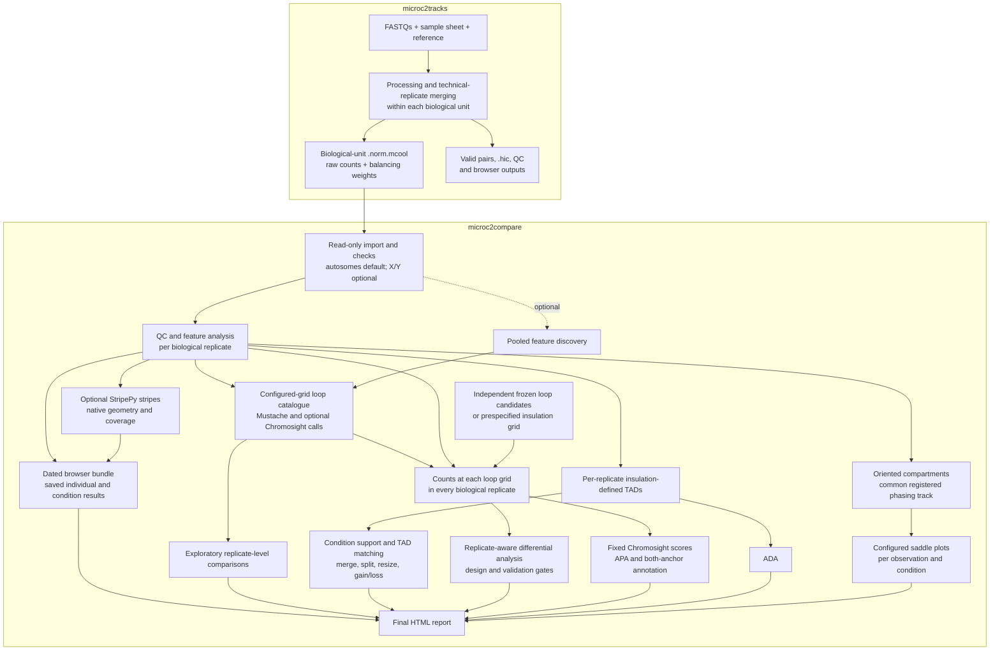

# microc2compare

Compare existing Micro-C/Hi-C matrices with a Bash entry script, `.conf` configuration, manifest tables, and Python/R scientific helpers. Imported `.cool`/`.mcool` matrices retain their raw pixels and stored balancing weights. Its structure follows the shell-based form of [microc2tracks](https://github.com/MichalGd/microc2tracks); the adapters here are original.

Implemented analyses include contact QC, raw/balanced P(s), HiCRep, oriented compartments, insulation and boundaries, descriptive domains, Mustache/cooltools loop discovery, optional independent Chromosight discovery and fixed-candidate scoring, raw feature counts, APA/ADA, fixed-partition saddles, optional StripePy stripes, browser exports, differential adapters, and optional pool/depth sensitivity. Pooling, thinning, and balancing of genuinely new maps require explicit selection. There is no Snakemake or Nextflow dependency.

**Current source candidate: 0.4.0.** New projects derive sample counts, conditions, references and available grids from their own registered inputs. The CPU scheduler and inner workers admit work from configured CPU/RAM reservations; parallel quantification, resumable aggregation and expected-contact caching reduce repeated work. Generic loop presets cover 400, 600, 800, 1000, 2000, 4000, 10000 and 20000 bp, with explicit exact-position pairs preparation when authentic fine grids are missing. Optional stripes and dated UCSC bundles with optional HiGlass conversion retain native feature coordinates and provenance. Start with the [general-purpose upgrade guide](docs/35-general-purpose-upgrade.md), [CPU loops and pairs](docs/cpu_loop_profiles.md), [browser export](docs/browser_export.md) and [stripe detection](docs/34-stripe-detection.md).

The `hsieh_8grid` and `short_range_4kb` presets adapt published methods; they do not reproduce the historical study or guarantee detection at 4 kb genomic separation. With the current Mustache parameters, the ideal occupancy floor is six bins: 2.4 kb at 400 bp, 3.6 kb at 600 bp and 4.8 kb at 800 bp. Coverage, masks and caller filters can raise that floor. Fine-grid scientific admission remains project-specific; coarse matrices are never interpolated into authentic finer grids.

**Validation status:** local checks cover fresh projects, unrelated assemblies, unequal condition sizes, unchanged input hashes, serial/parallel agreement, recovery, actual CPU caller APIs and isolated StripePy execution. Hosted Linux jobs additionally exercise the scientific core, actual fine callers, StripePy and decoded bigWig/interval/interaction conversion. Results are commit-specific; see [chronological verification](validation/local-verification.md), [the detailed record](validation/general-purpose-040-local.json) and the current branch checks. Target-server scaling, representative real-data near-4-kb/stripe sensitivity and installed HiGlass rendering remain separate acceptance steps. Formal biological inference retains its design and calibration gates.

## Software and analyses

The workflow combines established contact-map software with its own replicate-aware adapters. The tables describe the functions actually used by microc2compare; the linked projects may offer additional analyses. Genomic and statistical supporting packages are labelled separately from Micro-C/Hi-C software.

### Integrated software

| Software | Category | Brief description | Original project or documentation |
|---|---|---|---|
| **Cooler** | Micro-C/Hi-C matrices | Stores and queries sparse contact matrices in `.cool`/`.mcool` format; supports creating and coarsening new matrices. | [Cooler documentation](https://cooler.readthedocs.io/en/latest/) |
| **cooltools** | Micro-C/Hi-C analysis | Extracts compartment vectors, insulation scores and boundaries; provides an alternative local-enrichment dot caller. | [cooltools documentation](https://cooltools.readthedocs.io/en/latest/) |
| **HiCRep** | Micro-C/Hi-C reproducibility | Measures contact-map agreement using smoothing and a distance-stratified correlation coefficient (SCC). | [Python implementation](https://github.com/dejunlin/hicrep); [original method](https://doi.org/10.1101/gr.220640.117) |
| **Mustache** (`mustache-hic`) | Micro-C/Hi-C loop discovery | Detects focal chromatin contacts at multiple spatial scales in high-resolution contact maps. | [Mustache project and method description](https://github.com/ay-lab/mustache) |
| **Chromosight** | Micro-C/Hi-C pattern analysis | Detects loop patterns independently and scores fixed candidates with template correlation; the two functions are separate. | [Chromosight project](https://github.com/koszullab/chromosight); [original method](https://www.nature.com/articles/s41467-020-19562-7) |
| **StripePy** | Micro-C/Hi-C stripe discovery | Detects stripe anchors and bodies with native descriptors; runs in an optional isolated CPU environment. | [StripePy method and software](https://doi.org/10.1093/bioinformatics/btaf351) |
| **bioframe** | Genomic interval support | Finds overlaps between loop anchors and promoter, exon, gene-body and candidate regulatory-element intervals. | [bioframe documentation](https://bioframe.readthedocs.io/en/latest/) |
| **edgeR** | Statistical support | Fits replicate-aware count models with quasi-likelihood tests; used by the gated differential-loop adapter. | [edgeR package and documentation](https://bioconductor.org/packages/edgeR/) |
| **limma** | Statistical support | Fits linear models with moderated tests; used by the gated differential-insulation adapter. | [limma package and documentation](https://bioconductor.org/packages/limma/) |

Python/R, NumPy, SciPy, pandas, HDF5 and plotting libraries provide additional infrastructure. Reference resources such as GENCODE and ENCODE cCREs are annotation data, rather than analysis software. Imported sample matrices retain their upstream balancing weights; Cooler balancing is restricted to explicitly requested, genuinely new derived matrices.

### Which software performs which analyses?

| Software or workflow implementation | Analyses implemented in microc2compare | How it is used |
|---|---|---|
| **Cooler + microc2compare** | Contact QC, raw counts, matrix access, eligible-contact exposure, optional pooling and depth sensitivity | Reads original counts and stored weights; creates new derived maps only through explicit preparation or optional analyses. |
| **cooltools + microc2compare** | Compartments, insulation and boundary detection; alternative loop discovery | Calls `eigs_cis`, `insulation` and, when selected, `dots`; the workflow adds common masks, compartment orientation and provenance. |
| **HiCRep + microc2compare** | Pairwise contact-map concordance | Uses the Python HiCRep smoothing/SCC routines on raw counts in common chromosome views. |
| **Mustache + microc2compare** | Loop discovery at each configured resolution | Uses an adapter for multiscale discovery; the workflow builds consensus features and a catalogue retaining source calls. |
| **Chromosight + microc2compare** | Independent loop discovery and fixed-candidate scoring | Uses native correlation/focus picking on bounded inherited-weight/O/E tiles for discovery, and separate bounded windows for scoring. Caller support and scores are descriptive, not biological P values. |
| **StripePy + microc2compare** | Optional stripe discovery and descriptive support | Runs StripePy 1.3.0 on temporary raw cis maps split at excluded-bin gaps; preserves native anchor/body coordinates, descriptors and coverage. |
| **bioframe + microc2compare** | Both-anchor gene and cCRE annotation | Uses interval overlaps; the workflow adds gene-context priorities, nearest-TSS distances and loop-category summaries. |
| **edgeR + microc2compare** | Differential loop contact allocation | Uses raw integer counts, eligible-contact exposure and replicate-aware quasi-likelihood models when the requested inference gates pass. |
| **limma + microc2compare** | Differential insulation | Models continuous log2 insulation scores on the common fixed grid when the requested inference gates pass. |
| **microc2compare implementations** | P(s)/expected contacts, consensus features, TAD calling/matching, raw quantification, APA, ADA, fixed-partition saddles, descriptive comparisons, browser bundles and reports | Implements these calculations using the matrix/interval interfaces and scientific libraries above. APA/ADA/saddle aggregation is implemented in this repository. Browser export reads saved results; optional converters create HiGlass formats without server ingestion. |

### What the analysis modules measure

Select modules with `--analysis NAME[,NAME...]`; prerequisites and the selected report are included automatically. Resolutions and distance ranges are configurable. The practical preset retains 2/4-kb loops, while `hsieh_8grid` requests eight grids and `short_range_4kb` requests the first six. Every requested grid needs authentic input and any required scientific review. Insulation/TADs/ADA and compartments/saddles keep separately configured grids.

| Analysis type | Module name | What it measures or explains |
|---|---|---|
| **Contact QC and distance decay, P(s)** | `qc` | Contact totals, cis/trans composition, usable coverage and how raw/balanced contact frequency changes with genomic distance. |
| **Contact-map reproducibility** | `hicrep` | Pairwise SCC agreement between replicate maps, with chromosome-level measurements and a summary. |
| **A/B compartments** | `compartments` | Broad patterns of preferential chromatin association, with vectors oriented against a shared registered phasing track. |
| **Insulation and boundaries** | `insulation` | Contact insulation around genomic positions at several window sizes, identifying candidate domain boundaries. |
| **TAD/domain analysis** | `tads` | Boundary-derived domains, replicate support and descriptive domain differences such as splitting, merging or resizing. |
| **Loop discovery and consensus** | `loops` | Focal contacts between two genomic anchors, their replicate support and correspondence across configured resolutions. |
| **Independent Chromosight discovery** | `chromosight_discovery` | Native template-correlation calls at configured grids, combined with other callers while counting each observation once. |
| **Loop contact quantification** | `quantify` | Raw counts at the same candidate pixels in every replicate, with eligible-contact exposures and explicit missing/exclusion reasons. |
| **Loop-pattern scoring** | `chromosight` | How well each fixed candidate's local contact pattern matches the Chromosight loop template. |
| **Loop-anchor annotation** | `annotation` | Promoter/exon/intron/intergenic context, nearest genes/TSSs and cCRE overlaps at both anchors; annotations suggest potential regulatory relationships. |
| **Aggregate peak analysis, APA** | `apa` | Average observed/expected enrichment around loop anchor pairs, including the central contact and surrounding pattern. |
| **Aggregate domain analysis, ADA** | `ada` | Average observed/expected contacts within domains resized to a common shape, plus per-replicate domain-strength measurements. |
| **Compartment saddle analysis** | `saddle` | Average contacts between bins grouped by a shared compartment ranking, summarizing A-A, B-B and A-B segregation. |
| **Optional stripe discovery** | `stripes` | Stripe anchors/bodies, native signal descriptors, eligible coverage and descriptive cross-observation support. |
| **Condition comparisons** | `comparisons`, `loop_comparison`, `insulation_comparison` | Descriptive loop-allocation and insulation effects; biological P values/FDR are available only for explicitly requested, validated inferential analyses. |
| **Optional pooled discovery** | `pool` | Deeper condition/all-sample maps for discovery; individual biological units remain separate for replicate-level comparisons. |
| **Optional depth sensitivity** | `depth_sensitivity` | Reproducible contact thinning to assess depth effects through P(s), optional HiCRep and selected fixed-feature/insulation measurements. |
| **Unified browser export** | `browser_export` | Saved individual/condition tracks for enabled analyses, with exact geometry, coverage, source identities and optional HiGlass conversion. |
| **Final HTML report** | `report` | Methods, QC, results, downloadable tables and figures, including APA/ADA/saddles and volcano plots when eligible inferential loop results exist. |

O/E means **observed contacts divided by the expected contact frequency at the same genomic separation**. APA concerns focal anchor-pair enrichment; ADA concerns contacts across entire domains; saddle plots concern compartment segregation. Aggregate plots summarize many features but do not increase biological replicate numbers or establish significance by themselves. Condition aggregates give original observations equal weight and retain missing-pixel coverage. Several cultures from one donor remain one donor for biological replication.

Legacy full practical/Hsieh-inspired profiles require compartments, saddle plots and their final report; explicit module selections remain selective. The new generic loop presets preserve project-specific admission and do not confer historical validation. Depth sensitivity is optional and does not automatically repeat the full multiresolution pipeline. Descriptive comparisons do not supply biological P values or FDR; inferential comparisons require appropriate independent inputs, an estimable design and matching calibration. See [analysis modules](docs/17-analysis-modules.md), [CPU loop methods](docs/cpu_loop_profiles.md), [anchor annotation](docs/29-loop-anchor-annotation.md) and [statistical interpretation](docs/05-statistics.md).

## Simple project setup

The shared command handles software selection, private permissions and runtime caches internally. Start a new project with `microc2compare --init /your/project/config/project.conf --reference YOUR_ASSEMBLY --preset practical_2_4kb`; register that assembly's reference assets and edit experiment-specific inputs, outputs and budgets. Preparation, resource registration, resolution auditing/preparation and completion checks use the same `-c project.conf` interface. Existing prepared projects skip initialization/import. See the [0.4.0 project and upgrade guide](docs/35-general-purpose-upgrade.md) and [short project commands](docs/32-simple-project-commands.md).

## Workflow overview

A published launcher loads its checked software profile automatically. Users specify their own inputs, reference, outputs and parameters without a fixed `source` line or Conda activation. CPU/RAM admission can reduce requested concurrency; estimates still need representative Linux resource measurements.



Pooling is optional and off by default. Same-data consensus features feed exploratory comparisons; formal loop testing uses independently frozen candidates, and formal insulation testing uses the prespecified grid. The technical merge must represent one biological unit. Upstream merging follows per-row deduplication, so lanes/resequencing of the same library need verified joint-library deduplication upstream. New pools need their own weights when balanced analysis is explicitly requested; imported samples are never rebalanced.

## Essential scientific definitions

- **Biological replicate:** an independent animal or donor, with the experimental unit declared explicitly. Separately grown cultures within a donor can support descriptive analysis but do not add independent donors; nested-culture inference is unsupported. Matched donors require a paired design.
- **Technical replicate:** another library, sequencing lane or run from the same biological unit. Consolidating these does not increase biological sample size.
- **Balancing:** correcting contact-matrix bin biases with upstream weights. Raw counts and weights coexist inside `.norm.mcool`; downstream models still need their declared statistical exposure offsets.
- **Exploratory analysis:** QC, feature discovery and descriptive effects. Same-data consensus and pooled discovery do not authorize biological differential P values.
- **Formal differential analysis:** an explicit replicate-aware comparison passing design, input and calibration gates. See [statistics](docs/05-statistics.md) for the scoped policies.

New to the workflow? Follow [your first analysis](docs/14-first-analysis.md), then use the [documentation index](docs/README.md). The [glossary](docs/14-first-analysis.md#short-glossary) explains specialist terms.

For a specific task, use `--list-analyses` and `--analysis tads`, `--analysis saddle`, or a comma-separated selection. The runner enables prerequisites and produces the selected report without unrelated analyses. Omit selection for the configured full pipeline. Use a new run ID to preserve a parameter variant. The module catalogue documents inputs, launch commands, settings, exact output paths and interpretation for every analysis.

## Prepare inputs from microc2tracks

For a new import, list the upstream samplesheet/results paths once in `UPSTREAM_INPUTS` and run:

```bash
microc2compare -c /your/project/config/project.conf --prepare-inputs
```

The helper relates technical rows to biological-unit matrices, lists grids/count storage/weights and related products, and combines drafts from all listed upstream datasets. It preserves missing biological/library/processing facts as explicit review gaps. Existing completed sample/provenance tables are reused directly. See [simple project commands](docs/32-simple-project-commands.md) and the [worked handoff](docs/13-upstream-handoff.md); advanced standalone inventories remain available.

## Start on Linux

**New installation from GitHub:** follow [repository installation](docs/26-install-from-github.md) to install an immutable source release, reuse checked shared environments and publish a profile-bound command. The [detailed environment setup](docs/15-server-installation-start.md) explains cloning the upstream core into an independent shared prefix and creating isolated fallbacks only when needed.

The server deployment uses **shared software for all accounts, separate user workspaces**. A maintainer publishes readable/executable versioned releases and checked environments; users keep configurations, results, scratch and caches outside the installation. Follow [shared installation and the second-account test](docs/16-shared-server-installation.md) to publish the command and confirm access. The recommended core is a checked, versioned Conda clone; package changes stay separate from microc2tracks. Software uses a central manager outside homes. Each user chooses their own project/input/output/scratch directories, including projects under their home. `$HOME/microc2compare-work` is an installation/demo example, not a mandatory analysis location. Your home installation and shell startup files need no changes. Per-run resource limits need the site's scheduling policy to coordinate simultaneous users.

The maintainer installs Bash 4.4+, checked bootstrap/scientific software and the shared command once. Ordinary researchers use their normal Bash login and project configuration:

```bash
microc2compare --init "$HOME/my_microc_project/config/project.conf" --reference hg38 --preset practical_2_4kb
# Edit experiment-specific inputs, reference, outputs and resource budget.
microc2compare -c "$HOME/my_microc_project/config/project.conf" --audit-resolutions
microc2compare -c "$HOME/my_microc_project/config/project.conf" --analysis qc,hicrep --dry-run
microc2compare -c "$HOME/my_microc_project/config/project.conf" --analysis qc,hicrep
microc2compare -c "$HOME/my_microc_project/config/project.conf" --validate
# Inspect QC, then continue the compatible full configuration.
microc2compare -c "$HOME/my_microc_project/config/project.conf" --resume
```

Completed projects skip initialization and input reimport. Preparation operations print new sibling configurations; use those files when changing inputs. No manual profile source, environment activation, fixed cache exports or shell startup changes are required. Compartment/saddle analysis needs a usable common phasing track, and selected callers need checked optional environments. See the [0.4.0 upgrade guide](docs/35-general-purpose-upgrade.md). Only the maintainer provisions shared environments; ordinary analysis never updates packages.

## Synthetic demonstration

After initialization, the same shared command generates a separate six-sample QC fixture:

```bash
microc2compare -c "$HOME/my_microc_project/config/project.conf" --demo \
  --out "$HOME/my_microc_project/qc-demo001"
microc2compare -c "$HOME/my_microc_project/qc-demo001/project.conf" --analysis qc,hicrep
microc2compare -c "$HOME/my_microc_project/qc-demo001/project.conf" --validate
```

The fixture contains three simulated cultures per condition, one 6-Mb artificial chromosome, generated raw counts and known test weights at 10/100 kb. It executes weighted QC, HiCRep and reporting; it does not test omitted feature modules or provide statistical calibration. Destination overwrite is refused. Maintainer acceptance also runs the full fine-loop fixture from [the deployment guides](docs/33-simple-project-upgrade.md).

Results are under `OUTDIR/PROJECT/ANALYSIS_SET_ID/RUN_ID`; open `08_reports/index.html`. Resume uses the original configuration/versioned command and verifies input, source, parameter, environment, prerequisite and output identities. A completion filename alone is insufficient. Use `--variant NEW_RUN_ID --set PARAMETER=value` to create a separate configuration for parameter tuning. Configurations are trusted Bash; CSV/TSV rows remain data.

## Documentation

Use the [documentation index](docs/README.md) to choose a user, methods or administrator path.

| Guide | What it covers |
|---|---|
| [General-purpose 0.4.0 upgrade](docs/35-general-purpose-upgrade.md) | New projects, CPU admission, checkpoints, fine grids, stripes, browser exports and validation boundaries |
| [CPU loops and exact-position pairs](docs/cpu_loop_profiles.md) | Generic presets, independent Chromosight discovery, Mustache geometry, capability checks and explicit new-map preparation |
| [Unified browser export](docs/browser_export.md) | Saved individual/condition tracks, coordinate profiles, UCSC loading and optional HiGlass conversion |
| [Stripe detection](docs/34-stripe-detection.md) | Optional StripePy runtime, native geometry, descriptors, masks, outputs and interpretation |
| [Install from GitHub](docs/26-install-from-github.md) | Clone, immutable shared source release, checked environment reuse and automatic software settings |
| [Simple project commands](docs/32-simple-project-commands.md) | Compact setup, imports, registration, audits, variants, separate modules and validation |
| [First analysis](docs/14-first-analysis.md) | Beginner walkthrough, replication examples and glossary |
| [Server installation start](docs/15-server-installation-start.md) | Numbered reuse-first setup, selective environments, fixtures and upstream pilot preparation |
| [Shared server installation](docs/16-shared-server-installation.md) | All-user software access, maintainer/user roles, private workspaces, permissions and second-account acceptance |
| [Upstream handoff](docs/13-upstream-handoff.md) | Preview/import drafts from microc2tracks, output mapping and required review |
| [Installation](docs/01-installation.md) | Linux setup, immutable environment reuse and locks |
| [Inputs](docs/02-inputs.md) | Biological units, libraries, references, pools and provenance |
| [Configuration](docs/03-configuration.md) | Paths, switches and every variable |
| [Methods](docs/04-methods.md) | Quantities, feature definitions, masks and adapters |
| [Statistics](docs/05-statistics.md) | Independent candidates, offsets, designs and inference gates |
| [Operation](docs/06-operation.md) | Stage order, restart, failures, retention and validation |
| [Server resources](docs/07-server-resources.md) | Inventory, admission, memory and pilot measurements |
| [Validation](docs/08-validation.md) | Tests, calibration, public-data and release gates |
| [Outputs](docs/09-outputs.md) | Files, columns, figures and interpretation |
| [Analysis modules](docs/17-analysis-modules.md) | Standalone commands, exact inputs, parameters and outputs for every module |
| [TAD analysis](docs/18-tad-analysis.md) | Domain calls, replicate support, event matching and sensitivity |
| [R and inference](docs/19-r-environment-and-inference.md) | Reuse-first R inspection, numerical checks and calibration registration |
| [Candidate upgrade](docs/20-candidate-upgrade.md) | Transfer, immutable installation, server/second-user acceptance and activation |
| [Troubleshooting](docs/10-troubleshooting.md) | Actionable failures and upstream remediation |
| [Publication](docs/11-publication.md) | Local archive, GitHub preparation and licensing decisions |
| [Windows development](docs/12-windows-development.md) | Actual local verification commands and limits |

Original private planning documents, installation binaries, generated data and analysis results are excluded from this repository. Formal compartment/domain/stripe inference, causal regulatory claims and genome-wide differential pixels remain outside the implemented inferential scope. Source publication does not establish statistical calibration; [the license record](LICENSE.md) states the current distribution terms/decision.

## Repository and output layout

```text
config/        .conf template, resource presets and manifest examples
scripts/       Bash runner plus Python/R command-line adapters
src/           testable microc2compare Python helpers
schemas/       input/provenance contracts
envs/          optional isolated environments and lock instructions
docs/          user, scientific and administrator guides
examples/      synthetic demo and upstream-handoff sample sheet
tests/         numerical, metadata, handoff and restart checks
validation/    actual verification evidence and pending release gates
```

Runs use `OUTDIR/PROJECT/ANALYSIS_SET_ID/RUN_ID` with numbered QC, feature, quantification, comparison and report folders, plus `logs/`, `benchmarks/` and validated completion records. Open `08_reports/index.html`. Browser bundles under `browser_tracks/` include UCSC headers, BED/bedGraph/BEDPE, provenance and optional converted HiGlass products; upstream `.hic` files are reused separately. See [browser export](docs/browser_export.md) and [outputs](docs/09-outputs.md) for paths and interpretation.

Current CPU admission, checkpoint and migration behavior is described in the [0.4.0 upgrade guide](docs/35-general-purpose-upgrade.md); [performance and parallelism](docs/23-performance-and-parallelism.md) retains the earlier optimization history. Install the new candidate alongside the accepted release, use new run IDs, and complete target-server acceptance before changing a shared command.
