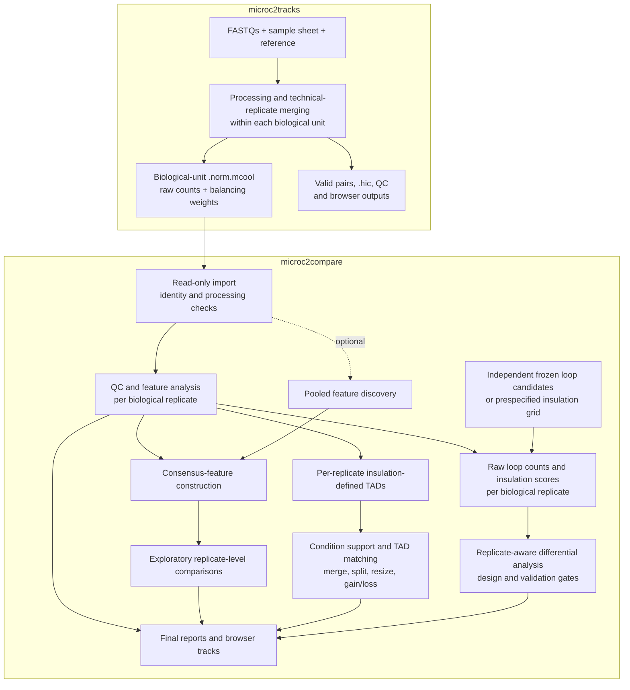

# microc2compare

Compare existing Micro-C/Hi-C biological-replicate matrices with a Bash entry script, `.conf` configuration, manifest tables, and Python/R scientific helpers. The v0.2 candidate reads raw pixels and stored balancing weights from upstream `.norm.mcool` files without modifying or copying them. Its structure follows the shell-based form of [microc2tracks](https://github.com/MichalGd/microc2tracks); the adapters here are original.

Implemented analyses include contact QC, raw/balanced P(s), HiCRep, oriented compartments, insulation and boundaries, descriptive domains, dots, deterministic consensus loops, raw feature counts, APA/ADA, fixed-partition saddles, differential adapters, and optional pool/depth sensitivity. Pooling, thinning, and balancing of genuinely new maps are disabled by default. There is no Snakemake or Nextflow dependency.

**Current version: 0.2.5.** Select individual analyses, preserve parameter variants, examine descriptive TAD changes, and export differential loop volcano plots when eligible model results exist. Shared launchers load checked software profiles automatically. See [the module catalogue](docs/17-analysis-modules.md), [TAD guide](docs/18-tad-analysis.md) and [volcano guide](docs/22-loop-volcano-plots.md).

**Validation status:** the maintainer reported full/selected/variant descriptive Linux acceptance, R numerical and basic non-owner access checks, followed by successful 0.2.5 automatic-profile QC/report acceptance and shared activation. Local tests passed 156 cases with three platform/runtime skips. Statistical calibration, a real-data biological pilot and full execution by another researcher remain pending; no passing calibration artifact is shipped. See [the verification record](validation/local-verification.md). These checks support starting a descriptive real-data pilot, not an unconditional production-inference claim.

## Workflow overview

**0.2.5 shared-user simplification:** a published launcher loads its checked software profile automatically. Users specify their own project inputs, outputs and parameters without a fixed `source` line or Conda activation. See [automatic software settings and the server upgrade](docs/25-automatic-software-profile.md).



Pooling is optional and off by default. Same-data consensus features feed exploratory comparisons; formal loop testing uses independently frozen candidates, and formal insulation testing uses the prespecified grid. The technical merge must represent one biological unit. Upstream merging follows per-row deduplication, so lanes/resequencing of the same library need verified joint-library deduplication upstream. New pools need their own weights when balanced analysis is explicitly requested; imported samples are never rebalanced.

## Essential scientific definitions

- **Biological replicate:** an independent animal, donor or culture. Keep each unit separate for comparison; matched donors require a paired design.
- **Technical replicate:** another library, sequencing lane or run from the same biological unit. Consolidating these does not increase biological sample size.
- **Balancing:** correcting contact-matrix bin biases with upstream weights. Raw counts and weights coexist inside `.norm.mcool`; downstream models still need their declared statistical exposure offsets.
- **Exploratory analysis:** QC, feature discovery and descriptive effects. Same-data consensus and pooled discovery do not authorize biological differential P values.
- **Formal differential analysis:** an explicit replicate-aware comparison passing design, input and calibration gates. See [statistics](docs/05-statistics.md) for the scoped policies.

New to the workflow? Follow [your first analysis](docs/14-first-analysis.md), then use the [documentation index](docs/README.md). The [glossary](docs/14-first-analysis.md#short-glossary) explains specialist terms.

For a specific task, use `--list-analyses` and `--analysis tads`, `--analysis saddle`, or a comma-separated selection. The runner enables prerequisites and produces the selected report without unrelated analyses. Omit selection for the configured full pipeline. Use a new run ID to preserve a parameter variant. The module catalogue documents inputs, launch commands, settings, exact output paths and interpretation for every analysis.

## Prepare inputs from microc2tracks

Preview the upstream sample sheet and results using a Python with `h5py` and NumPy, normally the checked upstream/core environment:

```bash
python scripts/prepare_microc2compare_inputs.py \
  --samplesheet /path/to/microc2tracks/config/samplesheet.csv \
  --upstream-results /path/to/microc2tracks/results --preview
```

The helper relates upstream rows to biological-unit matrices, prefers manifest-listed maps, lists resolutions/count storage/weights and related files, and flags problems. It writes nothing by default. `--write-drafts /new/project/config` exports editable CSV/TSV/JSON inputs into a new directory outside upstream results. Missing biological and processing evidence stays blank/null; this inventory does not replace preflight. See the [worked handoff guide](docs/13-upstream-handoff.md).

## Start on Linux

**New installation from GitHub:** follow [repository installation](docs/26-install-from-github.md) to install an immutable source release, reuse checked shared environments and publish a profile-bound command. The [detailed environment setup](docs/15-server-installation-start.md) explains cloning the upstream core into an independent shared prefix and creating isolated fallbacks only when needed.

The server deployment uses **shared software for all accounts, separate user workspaces**. A maintainer publishes readable/executable versioned releases and checked environments; users keep configurations, results, scratch and caches outside the installation. Follow [shared installation and the second-account test](docs/16-shared-server-installation.md) to publish the command and confirm access. The recommended core is a checked, versioned Conda clone; package changes stay separate from microc2tracks. Software uses a central manager outside homes. Each user keeps configurations, results, scratch and caches in their own home workspace, by default `$HOME/microc2compare-work`; another personal project directory is optional. Your home installation and shell startup files need no changes. Per-run resource limits need the site's scheduling policy to coordinate simultaneous users.

Use Bash 4.4+ and bootstrap Python 3.11+. Scientific commands run from this checkout; installing the project package is optional. An existing Conda executable is required for ordinary scientific environments. No analysis command updates an environment.

```bash
m2c_src="/path/to/shared/microc2compare-release"
m2c_config="$HOME/microc2compare-work/projects/pilot/config"
umask 077
mkdir -p "$m2c_config"
test ! -e "$m2c_config/project.conf" && \
  cp "$m2c_src/config/config_template.conf" "$m2c_config/project.conf"
# Edit project.conf, manifests and reference/provenance registrations.
# Use the published command; it loads software settings internally.
microc2compare -c "$m2c_config/project.conf" --dry-run
microc2compare -c "$m2c_config/project.conf" --until-stage qc
# Inspect QC, then continue the same descriptive configuration.
microc2compare -c "$m2c_config/project.conf" --resume
```

The template contains example paths and requires editing. Ordinary users use the published prefixes. Only the installation maintainer provisions missing shared environments through the separate, explicit bootstrap `--create-missing` action. Read [installation](docs/01-installation.md) before doing this on the server. A private environment is an optional development choice, not a requirement for each user.

## Synthetic demonstration

After creating and checking the core/HiCRep environments, run:

```bash
m2c_site="/opt/conda_envs/microc2compare/site/shared-design-json-fix-20261008.conf"
source "$m2c_site"
export PYTHONDONTWRITEBYTECODE=1
m2c_demo="$HOME/microc2compare-work/validation/full-demo-20261007"
"$CONDA_EXE" run --no-capture-output -p "$CORE_ENV_PREFIX" \
  python "$m2c_src/scripts/generate_demo.py" --out "$m2c_demo" \
  --core-prefix "$CORE_ENV_PREFIX"
printf '\nsource "%s"\n' "$m2c_site" >> "$m2c_demo/project.conf"
# The generated configuration sources resources_demo.conf.
# Reduce global and task budgets if the host allocation is smaller.
bash "$m2c_src/scripts/microc2compare.sh" -c "$m2c_demo/project.conf" --dry-run
bash "$m2c_src/scripts/microc2compare.sh" -c "$m2c_demo/project.conf"
```

The fixture contains three independent simulated cultures per condition and known test weights. It is descriptive and does not need R or a calibration artifact. The generator refuses to overwrite a nonempty destination. Its `--raw-only` flag disables cooltools features but **retains weighted QC** plus HiCRep/reporting; it does not mean that input weights are unnecessary or validate omitted modules. `--development` explicitly uses the invoking Python for local fixture testing.

Results are under `OUTDIR/PROJECT/ANALYSIS_SET_ID/RUN_ID`; open `08_reports/index.html`. Resume with the identical configuration:

```bash
microc2compare -c "$m2c_config/project.conf" --resume
microc2compare -c "$m2c_config/project.conf" --resume --rerun-stage loops
"$PYTHON_BOOTSTRAP" "$m2c_src/scripts/validate_outputs.py" --config-json /path/to/run/00_metadata/config.json
```

Resume verifies inputs, source, settings, environments, dependencies and product hashes. A `.done.json` filename alone is insufficient. `--from-stage` requires current prerequisite products. Configurations are trusted Bash files and are sourced; do not use untrusted configurations.

## Documentation

Use the [documentation index](docs/README.md) to choose a user, methods or administrator path.

| Guide | What it covers |
|---|---|
| [Install from GitHub](docs/26-install-from-github.md) | Clone, immutable shared source release, checked environment reuse and automatic software settings |
| [First analysis](docs/14-first-analysis.md) | Beginner walkthrough, replication examples and glossary |
| [Server installation start](docs/15-server-installation-start.md) | Numbered reuse-first setup, selective environments, fixtures and upstream pilot preparation |
| [Shared server installation](docs/16-shared-server-installation.md) | All-user software access, maintainer/user roles, private workspaces, permissions and second-account acceptance |
| [Upstream handoff](docs/13-upstream-handoff.md) | Preview/import drafts from microc2tracks, output mapping and required review |
| [Installation](docs/01-installation.md) | Linux setup, immutable environment reuse and locks |
| [Inputs](docs/02-inputs.md) | Biological units, libraries, references, pools and provenance |
| [Configuration](docs/03-configuration.md) | Paths, switches and every variable |
| [Methods](docs/04-methods.md) | Quantities, feature definitions, masks and adapters |
| [Statistics](docs/05-statistics.md) | Independent candidates, offsets, designs and inference gates |
| [Operation](docs/06-operation.md) | Stage order, restart, failures, retention and validation |
| [Server resources](docs/07-server-resources.md) | Inventory, admission, memory and pilot measurements |
| [Validation](docs/08-validation.md) | Tests, calibration, public-data and release gates |
| [Outputs](docs/09-outputs.md) | Files, columns, figures and interpretation |
| [Analysis modules](docs/17-analysis-modules.md) | Standalone commands, exact inputs, parameters and outputs for every module |
| [TAD analysis](docs/18-tad-analysis.md) | Domain calls, replicate support, event matching and sensitivity |
| [R and inference](docs/19-r-environment-and-inference.md) | Reuse-first R inspection, numerical checks and calibration registration |
| [Candidate upgrade](docs/20-candidate-upgrade.md) | Transfer, immutable installation, server/second-user acceptance and activation |
| [Troubleshooting](docs/10-troubleshooting.md) | Actionable failures and upstream remediation |
| [Publication](docs/11-publication.md) | Local archive, GitHub preparation and licensing decisions |
| [Windows development](docs/12-windows-development.md) | Actual local verification commands and limits |

Original private planning documents, installation binaries, generated data and analysis results are excluded from this repository. Formal compartment/domain inference, stripes, regulatory integration and genome-wide differential pixels are deferred explicitly. Source publication does not establish statistical calibration; [the license record](LICENSE.md) states the current distribution terms/decision.

## Repository and output layout

```text
config/        .conf template, resource presets and manifest examples
scripts/       Bash runner plus Python/R command-line adapters
src/           testable microc2compare Python helpers
schemas/       input/provenance contracts
envs/          optional isolated environments and lock instructions
docs/          user, scientific and administrator guides
examples/      synthetic demo and upstream-handoff sample sheet
tests/         numerical, metadata, handoff and restart checks
validation/    actual verification evidence and pending release gates
```

Runs use `OUTDIR/PROJECT/ANALYSIS_SET_ID/RUN_ID` with numbered QC, feature, quantification, comparison and report folders, plus `logs/`, `benchmarks/` and validated completion records. Open `08_reports/index.html`. Browser outputs are bedGraph signals and interval tables; upstream `.hic` files are reused separately. See [outputs](docs/09-outputs.md) for exact paths and interpretation.
